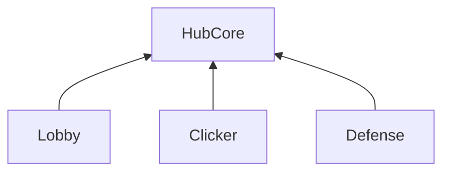

# AMU

로비에서 포탈을 통해 여러 장르의 레벨을 오가고, 각 레벨에서 얻은 공용 재화로 새로운 장르를 해금해 나가는 **Unreal Engine 5 C++ 장르 허브 게임**.

> AMU(아무): "아무거나 만들 수 있고, 아무나 들어와 서로의 누군가가 되어주는 곳"

## 핵심 루프

```
Lobby ──포탈──▶ 장르 레벨 (Clicker / Defense ...)
  ▲                 │
  │            플레이 · 보상
  └──── 공용 재화 획득 ◀──┘
        │
        └──▶ 공용 재화로 새 장르 해금
```

## 주요 기능

### Lobby
- 포탈 상호작용으로 장르 레벨 이동
- 잠긴 레벨 진입 시 해금 확인 팝업 (가격 / 보유 재화 표시, 재화 부족 시 확인 비활성화)
- 공용 재화 HUD 실시간 갱신 (델리게이트 기반)

### Clicker
- 클릭 / 초당 재화 획득, 지수형 비용의 업그레이드
- 오프라인 보상 (최대 8시간), 60초 주기 자동 저장
- GameplayTag + DataAsset 기반 ActionButton 컴포넌트 (아이콘 / 텍스트 / 아이콘+텍스트 모드)
- 토스트 · 플로팅 텍스트 위젯 풀링, Niagara 클릭 이펙트

### Defense
- 그리드 타일 기반 BFS 경로 탐색
- 타워 배치 시 경로 재계산, 스폰→목표 경로나 이동 중인 적의 경로를 막는 배치는 거부
- 웨이브별 적 수 증가, 라이프, 승리 / 패배 결과 화면
- 매치 결과에 따른 공용 재화 정산 후 로비 복귀

### 공통 시스템
- **공용 재화 / 진행도**: GameInstance Subsystem으로 레벨 전환 간 유지, 변경 시 즉시 저장 및 변경 이벤트 발행
- **레벨 해금**: GameplayTag(`Level.*`)로 레벨 식별, 해금 가격과 초기 해금 레벨은 DataAsset으로 관리
- **세이브**: 단일 SaveGame에 공용 데이터와 레벨별 스냅샷 저장. 레벨 스냅샷은 GameplayTag 키 + `FInstancedStruct`로 저장해 SaveManager가 개별 레벨 타입을 알지 않음
- **HUD 레이어**: Main / Floating / Toast / Modal 레이어로 구성된 공통 루트 위젯

## 아키텍처

### 모듈 구성



| 모듈 | 역할 |
|---|---|
| **HubCore** | 공용 계층: 세이브, 공용 재화 · 진행도, 공통 베이스 클래스(GameMode / PlayerController / WorldSubsystem), 포탈, 캐릭터, 공통 UI(루트 위젯, ActionButton, 토스트) |
| **Lobby** | 로비 GameMode / PlayerController, 로비 UI, 해금 확인 팝업 |
| **Clicker** | 클리커 경제, HUD, 클릭 타깃 |
| **Defense** | 그리드 · 경로, 타워 · 적, 웨이브, 결과 화면 |

장르 모듈은 HubCore에만 의존하고 서로를 참조하지 않으며, HubCore는 어떤 장르도 알지 않음. 의존 방향은 각 모듈의 `Build.cs`로 컴파일 단계에서 강제됨.

### 설계 원칙
- **Settings / Snapshot / Subsystem 분리**: 튜닝 값은 DataAsset, 저장되는 상태는 Snapshot 구조체, 규칙과 로직은 Subsystem
- **수명 단위 분리**: 레벨 간 유지되는 시스템은 GameInstance Subsystem, 레벨 전용 시스템은 해당 GameMode에서만 생성되는 World Subsystem
- **의존 방향**: 범용 → 특정 참조 금지. 게임플레이 → UI 요청은 PlayerController의 가상 함수 훅을 거침
- **이벤트 기반 갱신**: 오래 사는 시스템이 델리게이트로 알리고, 짧게 사는 UI가 스스로 구독 / 해제

## 개발 환경
- Unreal Engine 5.4.4
- Visual Studio 2022 (Windows)
- C++

## 빌드 / 실행
1. `Amu.uproject` 우클릭 → Generate Visual Studio project files
2. `Amu.sln` 실행 → `Development Editor` / `Win64` 빌드
3. `Amu.uproject`로 에디터 실행 (시작 맵: `L_Lobby`)

> 마켓플레이스 등 서드파티 에셋은 라이선스상 저장소에 포함하지 않음.

## 문서
- design
  - [Game Design](./design/game_design.md)
  - [Economy System](./design/system/system_economy.md)
  - [UI System](./design/system/system_ui.md)
- tech
  - [API Reference](./tech/api_reference.md)
  - [Architecture Overview](./tech/architecture_overview.md)
- planning
  - [Planning (Roadmap / Weekly / Daily)](./planning/)
  - [Branching Policy](./branching_policy.md)
- logs
  - [Devlog](./devlog/)
  - [Changelog](./logs/changelog.md)
- testing
  - [Test Cases](./testing/test_cases.md)

## Versioning
- v0.1-core-stable: Core systems & UI architecture stabilized (pre-art assets)
